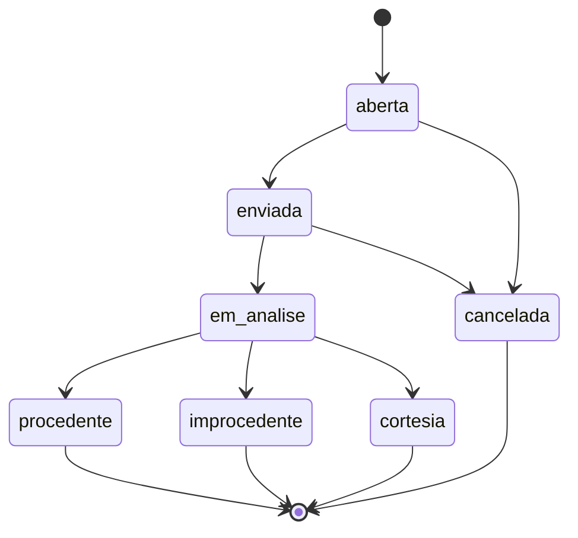
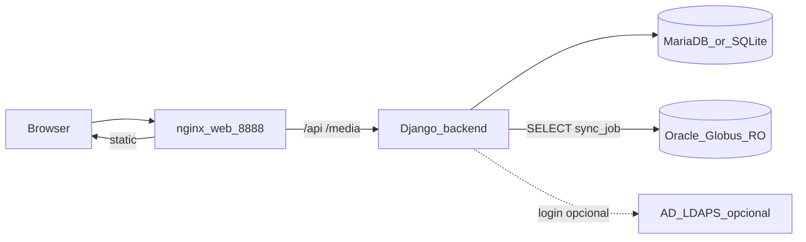

# SGGI — Documentação completa

Documento mestre do **Sistema de Gestão de Garantias Improcedentes**.  
Descreve o produto **como está no código hoje**. Em caso de conflito com a spec histórica, **este documento + o código prevalecem**.

| Item | Valor |
|------|--------|
| Produto | SGGI |
| Frase de produto | *O Globo controla estoque. O SGGI controla o rastro da garantia.* |
| Idioma da UI | Português (Brasil) |
| Monorepo | `backend/` · `frontend/` · `deploy/` · `docs/` · `scripts/` |

---

## 1. Visão do produto

O SGGI rastreia o ciclo de garantia de peças da frota (NF de remessa, anexos, status, custos, relatórios) **sem movimentar estoque**.

### Regra inegociável

- Não dá **entrada**, não dá **baixa**, não altera **saldo** no Globo/ERP.
- Status `improcedente` e `cortesia` **nunca** disparam lógica de estoque.
- `nf_entrada_globo` é **somente texto** e só faz sentido em `procedente` (espelho informativo).

### Dor que resolve

Antes, improcedentes e cortesias ficavam só no Excel; não havia associação clara remessa ↔ retorno nem visão gerencial por ano/fornecedor/peça. O SGGI digitaliza o **processo**; o Globo continua dono do **estoque**.

---

## 2. Fluxo de negócio e status

Fluxo típico:

1. Peça comprada / aplicada no veículo (contexto no Globo).
2. Falha dentro da garantia → abertura de caso no SGGI (cadastro da NF de remessa + anexos).
3. Peça enviada ao fornecedor (remessa).
4. Retorno com laudo / análise.
5. Encerramento: **procedente**, **improcedente** ou **cortesia**.

### Status válidos

```
aberta → enviada → em_analise → procedente | improcedente | cortesia
aberta / enviada → cancelada
```

| Status | Significado na UI (resumo) |
|--------|----------------------------|
| `aberta` | Caso aberto / laudo |
| `enviada` | Remessa ao fornecedor |
| `em_analise` | Em análise |
| `procedente` | Aceito pelo fornecedor (espelho NF Globo só texto) |
| `improcedente` | Negado — sem estoque |
| `cortesia` | Cortesia comercial — sem estoque padrão |
| `cancelada` | Cancelado |

- Protocolo: `GAR-AAAA-NNNNNN` (ex.: `GAR-2026-000001`).
- Toda mudança de status gera `EventoGarantia` (timeline).
- Na lista, filtros amigáveis: **Todas** / **Em andamento** (`abertos`) / **Improcedentes**.



---

## 3. Perfis e permissões

Perfis em `Usuario.perfil` (backend `apps/core/models.py` e frontend `src/auth/permissions.ts`):

| Perfil | Criar | Editar | Anexar | Vincular NF | Avançar status | Fechar (final) | Excluir |
|--------|-------|--------|--------|-------------|----------------|----------------|---------|
| `oficina` | sim | sim | sim | não | não | não | abertos |
| `compras` | não | sim | sim | sim | intermediários | não | abertos |
| `manutencao` | sim | sim | sim | não | intermediários | sim | abertos |
| `direcao` | não | não | não | não | não | não | não |
| `admin` | sim | sim | sim | sim | tudo | sim | abertos e fechados |

- **Intermediários:** `enviada`, `em_analise`, `cancelada` (com regras de origem).
- **Finais:** `procedente`, `improcedente`, `cortesia`.
- **Exclusão:** abertos (`aberta` / `enviada` / `em_analise`) para quem edita; admin também pode apagar fechados (limpeza/teste). Confirmação na UI via Dialog (não `window.confirm`).

Seed local típico (ver README): `admin`/`admin123`, `oficina`/`oficina123`, etc.

---

## 4. Arquitetura do monorepo

```
Proj_SGGI/
├── backend/                 # Django 5 + DRF + SimpleJWT
│   ├── apps/core/           # domínio único (models, views, globus, ldap…)
│   ├── rastroglobus/        # settings, urls, wsgi
│   ├── manage.py
│   ├── requirements.txt
│   └── Dockerfile
├── frontend/                # Vite + React 18 + TS + Tailwind + shadcn/ui
│   ├── src/pages/           # telas
│   ├── src/components/ui/   # primitives shadcn
│   └── package.json
├── deploy/                  # Dockerfile.web + nginx
├── docs/                    # esta documentação + POPs / ops
├── scripts/                 # sync Globus, import planilha, go-live
├── certs/                   # CA LDAPS (não versionar segredos)
├── conf/                    # Oracle Globus (chave.key, erp.dat) — não versionar
├── docker-compose.yml       # db + backend + web :8888
├── .env.example
└── RASTROGLOBUS-CURSOR-SPEC.md   # spec histórica do MVP
```

### Stack

| Camada | Tecnologia |
|--------|------------|
| API | Django 5, DRF, SimpleJWT, CORS |
| Auth corporativa | LDAP/AD opcional (`AD_LDAP_*`, auth-only) |
| Banco | SQLite (dev) ou MariaDB/MySQL |
| UI | React 18, Vite, TypeScript, Tailwind 3, React Router 6 |
| UI kit | shadcn/ui (Button, Input, Label, Textarea, Dialog, Sheet, Badge, Sonner) |
| Deploy | Docker Compose: MariaDB + Gunicorn backend + nginx (frontend estático + proxy `/api` `/media`) |



---

## 5. Modelo de dados (principais)

Fonte: `backend/apps/core/models.py`.

| Modelo | Papel |
|--------|--------|
| `Usuario` | User Django + `perfil` |
| `Fornecedor` / `Veiculo` / `Peca` | Cadastros SGGI (podem ser criados via `ensure` a partir do Globus) |
| `NotaFiscal` | Tipos: compra, remessa, retorno, entrada_procedente |
| `Garantia` | Caso (protocolo, status, NFs, valor, laudo, causas improcedente, observações…) |
| `EventoGarantia` | Timeline imutável de mudanças |
| `Anexo` | Arquivos da garantia (foto NF, PDF, DOC…) |
| `HistoricoGarantiaMensal` | Totais importados da planilha BASE GERAL |
| `PecaGlobus` / `VeiculoGlobus` / `FornecedorGlobus` / `CompraGlobus` / `SaidaGlobus` | Espelhos locais (somente leitura do Oracle) |
| `SyncLog` | Últimos syncs Globus |
| `RegraPrazoGarantia` | Regras de prazo dias/km |
| `AlertaReincidencia` | Alertas gerados por `detectar_reincidencia` |

Campos úteis no cadastro “Cadastrar nota”: NF remessa/série/data, NF origem, valor, peça, veículo, fornecedor, defeito, observação (`OBS:` em `observacoes`), anexos; opcional fechar improcedente na hora (`fechar-improcedente-direto`).

---

## 6. API REST

Base: `/api/` (router + views em `backend/apps/core/urls.py`).

### Auth

| Método | Path | Descrição |
|--------|------|-----------|
| POST | `/api/auth/login/` | Login (local e/ou LDAP) → JWT |
| POST | `/api/auth/refresh/` | Refresh token |
| GET | `/api/auth/me/` | Usuário autenticado |

### Recursos (ViewSets)

| Prefixo | Uso |
|---------|-----|
| `/api/fornecedores/` | CRUD + `POST …/ensure/` |
| `/api/veiculos/` | idem |
| `/api/pecas/` | idem |
| `/api/notas/` | NFs |
| `/api/garantias/` | Casos (list/create/detail/update/delete) |
| `/api/regras-prazo/` | Regras de prazo |
| `/api/alertas-reincidencia/` | Alertas (+ ações descartar / abrir-garantia) |

### Ações em garantia (exemplos)

| Método | Path | Descrição |
|--------|------|-----------|
| POST | `/api/garantias/{id}/anexos/` | Upload multipart de anexo |
| POST | `/api/garantias/{id}/notas/` | Vincular NF |
| POST | `/api/garantias/{id}/fechar-improcedente-direto/` | Encerrar improcedente direto |
| POST | `/api/garantias/extrair-danfe/` | OCR por foto (se API key configurada) |
| POST | `/api/garantias/consultar-chave-nfe/` | Consulta chave NF-e |
| GET | `/api/garantias/{id}/historico-globus/` | Histórico ligado ao Globus |
| GET | `/api/garantias/?status=&ano=&q=` | Filtros (`status=abertos` = em andamento) |

### Relatórios

| Path | Descrição |
|------|-----------|
| `/api/relatorios/resumo/?ano=` | Contagens e valores por status |
| `/api/relatorios/rankings/` | Rankings consolidados |
| `/api/relatorios/ranking-pecas/` / `ranking-veiculos/` | Rankings |
| `/api/relatorios/erro-interno/` | Erro interno / causas |
| `/api/relatorios/improcedentes-compras/` | Improcedentes × compras Globus |
| `/api/relatorios/historico/` | Histórico planilha |
| `/api/relatorios/export.csv/` | Export CSV |
| `/api/dashboard/` | Agregados dashboard |

### Globus (leitura)

| Path | Descrição |
|------|-----------|
| `/api/globus/status/` | Último SyncLog |
| `/api/globus/local/pecas/` · `local/veiculos/` | Espelho local |
| `/api/globus/pecas/` · `veiculos/` | Oracle ao vivo (alternativa) |
| `/api/globus/nf/` | NF ao vivo |
| `/api/globus/compras/` · `movimentos/` | Consultas auxiliares |
| `/api/globus/nfs-garantia/` | NFs garantia |

Autenticação das rotas de API: JWT Bearer (exceto login/refresh conforme configuração).

---

## 7. Frontend atual

### Menu principal (enxuto)

Em `AppLayout`: **Notas** · **Cadastrar** (se perfil pode criar) · **Relatórios**.  
Mobile: sidebar oculta + **Sheet** (drawer) com o mesmo menu.

### Rotas (`frontend/src/App.tsx`)

| Rota | Tela | Função |
|------|------|--------|
| `/login` | `Login` | Entrada JWT; sem credenciais pré-preenchidas |
| `/` | `GarantiasList` | Lista + KPIs + filtros + exclusão com Dialog |
| `/garantias/nova-danfe` | `GarantiaDanfe` | **Cadastrar nota** (fluxo principal) |
| `/garantias/:id` | `GarantiaFicha` | Detalhe, timeline, anexos, fechamento |
| `/relatorios` | `Relatorios` | Relatório unificado |
| `/garantias/nova` | `GarantiaNova` | Fluxo legado (ainda na rota) |
| `/alertas-reincidencia`, `/dashboard`, … | redirects | → `/` ou `/relatorios` |

Proxy de desenvolvimento (`vite.config.ts`): `/api` e `/media` → `http://localhost:8000`.

### UX / UI kit

- Tema dark próprio (cyan) em `index.css` + tokens shadcn.
- Primitives em `frontend/src/components/ui/`.
- Toast (Sonner) em salvar/login/excluir.
- Formulário Cadastrar: Série visível, Observação opcional (`OBS:`), multi-anexos, atalhos de defeito, checkbox improcedente (manutenção/admin).

---

## 8. Integração Globus

- Oracle Globus é lido **só pelo job** `sync_globus` (SELECT) e por algumas consultas ao vivo com timeout.
- **Não grava** no Globo e **não movimenta estoque**.
- Credenciais: pasta `conf/` (`chave.key` + `erp.dat`) + Instant Client (`ORACLE_CLIENT_LIB_DIR` ou `conf/oracle_client_dir.txt`).

```bash
cd backend
python manage.py sync_globus
python manage.py sync_globus --full
python manage.py sync_globus --tipo compras
python manage.py sync_globus --tipo saidas
python manage.py detectar_reincidencia
```

Scripts Windows: `scripts/sync_globus_job.ps1`, `scripts/register_sync_globus_task.ps1`.

---

## 9. Como rodar

### Docker (servidor)

```bash
cp .env.example .env
# edite SECRET_KEY, DB_*, ALLOWED_HOSTS

docker compose up -d --build
docker compose exec backend python manage.py seed   # 1ª vez
```

App: `http://<host>:8888` (nginx → frontend + `/api` + `/media`).  
Código típico no servidor: `/var/www/sggi`.

### Backend local

```bash
cd backend
python -m venv .venv
# Windows: .venv\Scripts\activate
pip install -r requirements.txt
python manage.py migrate
python manage.py seed
python manage.py runserver
```

API: `http://localhost:8000/api/`

MariaDB: configurar `DB_ENGINE` / `DB_*` em `backend/.env` (ver `backend/.env.example`) e `python manage.py check_db`.

### Frontend local

```bash
cd frontend
npm install
npm run dev
```

App: `http://localhost:5173`.

### Variáveis relevantes

Raiz (`.env.example`): `SECRET_KEY`, `DEBUG`, `ALLOWED_HOSTS`, `DB_*`, `AD_LDAP_*`, OCR (`OPENAI_*`), Globus.

Backend (`backend/.env.example`): banco, Globus, OCR, LDAP.

---

## 10. Operação, LDAP e go-live

Documentos especializados (não duplicados aqui):

| Documento | Conteúdo |
|-----------|----------|
| [POP_DESENVOLVIMENTO_E_OPERACAO.md](POP_DESENVOLVIMENTO_E_OPERACAO.md) | POP desenvolvimento e operação |
| [POP_CHECKLIST_OPERACIONAL.md](POP_CHECKLIST_OPERACIONAL.md) | Checklist operacional |
| [COMANDOS_SERVIDOR_SGGI.md](COMANDOS_SERVIDOR_SGGI.md) | Comandos no servidor |
| [MIGRATE_SERVER_TO_SGGI.md](MIGRATE_SERVER_TO_SGGI.md) | Migração no servidor |
| [CHECKLIST_HOMOLOG_LDAP.md](CHECKLIST_HOMOLOG_LDAP.md) | Homologação LDAP |
| [SOLICITACAO_INFRA_LDAP_SGGI.md](SOLICITACAO_INFRA_LDAP_SGGI.md) | Pedido à infra (LDAPS) |
| [ops/programa-cutover-improcedentes.md](ops/programa-cutover-improcedentes.md) | Cutover improcedentes |
| [ops/operacao-diaria-novos-rg.md](ops/operacao-diaria-novos-rg.md) | Operação diária |
| [ops/status-100-pct.md](ops/status-100-pct.md) | Status go-live |
| [ops/incoming/README.md](ops/incoming/README.md) | Entrada de planilhas |
| [MANUAL_USUARIO_SGGI.pdf](MANUAL_USUARIO_SGGI.pdf) | Manual do usuário (PDF) |
| [../certs/README.md](../certs/README.md) | CA para LDAPS |

LDAP: autenticação **somente** (não altera o AD). Manter `AD_LDAP_ENABLED=0` até homologar.

Import histórico (totais mensais, não cria `Garantia`):

```bash
cd backend
python manage.py import_planilha caminho\GARANTIA-2026.xlsx --dry-run
python manage.py import_planilha caminho\GARANTIA-2026.xlsx
```

---

## 11. Spec histórica vs código atual

| Artefato | Papel |
|----------|--------|
| [RASTROGLOBUS-CURSOR-SPEC.md](../RASTROGLOBUS-CURSOR-SPEC.md) | Spec original do MVP para o Cursor |
| [README.md](../README.md) | Quick start e regras |
| **Este arquivo** | Documentação mestre do estado atual |

Diferenças típicas em relação à spec antiga:

- Menu enxuto (Notas / Cadastrar / Relatórios), sem reincidência como item principal.
- Cadastro principal via **Cadastrar nota** (`GarantiaDanfe`), com série, observação, multi-anexos e toast.
- UI com **shadcn/ui** e layout responsivo (Sheet mobile).
- Exclusão de garantias **existe** na API/UI (com regras de perfil/status).
- Integração Globus e LDAP evoluíram além do “MVP sem ERP”.

---

## 12. Testes e qualidade

Backend (Django):

```bash
cd backend
python manage.py test apps.core
```

Coberturas relevantes em `backend/apps/core/tests/` (login, planilha, fechar improcedente, chave NF-e, Globus sync, erro interno, etc.).

Frontend:

```bash
cd frontend
npm run build
```

---

## 13. Glossário rápido

| Termo | Significado |
|-------|-------------|
| Remessa | NF de envio da peça ao fornecedor |
| Retorno | NF/laudo de volta do fornecedor |
| Improcedente | Garantia negada; sem entrada de estoque |
| Cortesia | Fornecedor cede sem admitir defeito |
| Procedente | Aceito; `nf_entrada_globo` só como texto |
| Espelho Globus | Tabelas locais atualizadas por sync SELECT |
| Protocolo | Identificador `GAR-AAAA-…` do caso |

---

*Última consolidação alinhada ao monorepo com frontend enxuto + shadcn e backend `apps.core`.*
